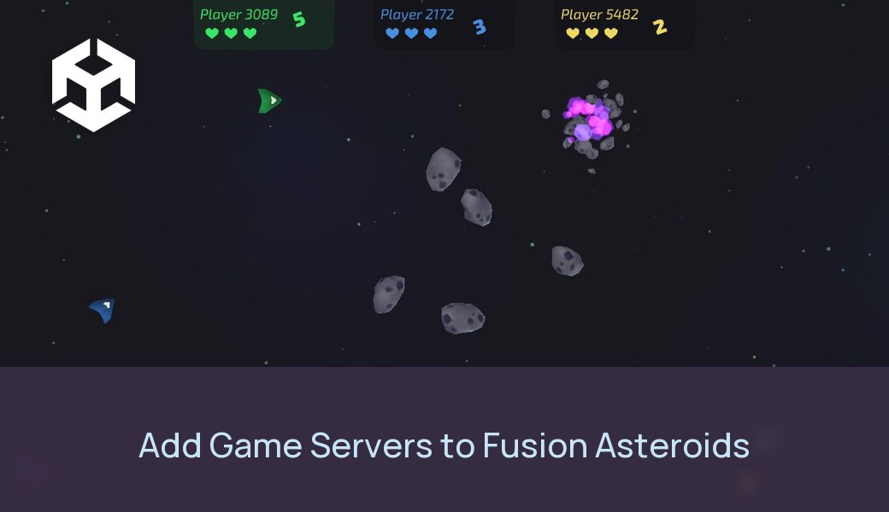

# Photon Fusion 2 sample project

This guide will help you create a headless server on Edgegap for a Unity project using [Photon Fusion 2]( https://doc.photonengine.com/en-us/fusion/current/getting-started/fusion-intro) as its networking solution. You will need an account with both Edgegap and Photon for this.

We will use the sample project [Asteroid Simple (Host)](https://doc.photonengine.com/fusion/current/game-samples/fusion-asteroids) from Photon Fusion as an example.

## Tutorial

To test this sample:

- Clone the repo via the `git clone [URL]` command;
- In the Unity editor, set these values with your own:
    - In `PhotonAppSettings.asset`: `App Id Fusion`;
- Make sure both scenes under `Assets/Asteroids-Host-Simple/Scenes` are included in the build settings.
- Build & containerize your server then create a new app verison with the Edgegap plugin.
- Add app version port mapping with name `gameport`, internal port `7777`, and protocol `UDP`.
- Start a new deployment via the Edgegap dashboard/plugin.
- Before launching the client:
    - Enter the [Photon region](https://doc.photonengine.com/fusion/current/manual/connection-and-matchmaking/regions#available-regions) that corresponds to the server's deployed location in `PhotonAppSettings.asset`: `Fixed Region`. If left empty, it will by default use the Photon region with the lowest ping.
- Launch the game in the editor:
    - For room name, input your deployment's Host URL as shown in dashboard, in format `{request_id}.pr.edgegap.net`.
    - Click on `Start Edgegap`.

The game will search for an available room with the specified name. After a short moment, the client should successfully connect to the server.

## Troubleshooting

- If the client is unable to connect to the specified room name with an error code of `Game Does Not Exist (32758)` but the server is up and running correctly, it's possible that the [region](https://doc.photonengine.com/fusion/current/manual/connection-and-matchmaking/regions#available-regions) used by the client does not correspond to the same region that the server is in. You can double-check the server's location using the deployment map on the Edgegap dashboard, and compare it to the region code set in `PhotonAppSettings.asset`: `Fixed Region`.

You can see the full documentation [here](https://docs.edgegap.com/docs/sample-projects/photon-fusion-2-on-edgegap).
